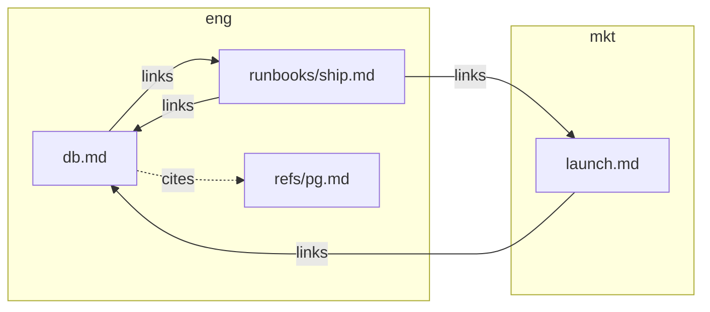

# KnowledgeBaseMCP

!!! note "AI-generated"
    These pages were written with Claude Opus 5.5 and are under human review.

An MCP server and command line for [Open Knowledge Format][okf] (OKF) v0.2
knowledgebases: directories of Markdown concepts with YAML frontmatter,
grouped into bundles. It checks, maintains and imports them. It cares how a
concept is written, never what it says.

One contract, three users:

- **An agent** over MCP: every tool, with diffs before writes and a
  confirmation prompt before anything records a human.
- **CI**: `lint` with GitHub annotations or SARIF, a baseline for old
  findings, `since=` for pull requests.
- **A person at a terminal**, no AI involved: `help`, readable text output,
  and `--attest` to sign your own reviews.

Local files only. No network. Never writes to git. One Python file, run with
[uv](https://docs.astral.sh/uv/).

## Quickstart

```sh
# start a bundle
uv run KnowledgeBaseMCP.py init bundle=eng apply=true

# write a concept
uv run KnowledgeBaseMCP.py create eng/runbooks/deploy \
    type=Playbook description="How we deploy."

# what's wrong, each with a fix; then the mechanical repairs
uv run KnowledgeBaseMCP.py lint format=text
uv run KnowledgeBaseMCP.py fix apply=true

# any tool: what it does, its arguments
uv run KnowledgeBaseMCP.py help move
```

Register it with Claude Code:

```sh
claude mcp add knowledgebase --env KB_ROOT=/path/to/kb \
    -- uv run /path/to/KnowledgeBaseMCP.py
```

## What a knowledgebase looks like

A knowledgebase is a folder of bundles. A bundle is a folder of concepts, one
Markdown file each. Two small bundles:

```text
kb/
  index.md                 lists the bundles
  eng/                     a bundle: its index.md declares okf_version "0.2"
    index.md
    log.md                 what changed, newest first
    db.md
    runbooks/ship.md
    refs/pg.md
  mkt/
    index.md
    log.md
    launch.md
```

Each concept is frontmatter (what kind of thing it is, where its facts came
from, who checked it) over an ordinary Markdown body. Here is `eng/db.md`:

```markdown
---
type: Reference
title: Database
description: The PostgreSQL cluster behind every service.
sources:
  - id: pg
    resource: refs/pg.md
verified: { by: human:dfoulks, at: 2026-10-27T14:00:00Z }
---

We run PostgreSQL 16.4.[^pg] Deploys follow [the ship runbook](/runbooks/ship.md).

[^pg]: PostgreSQL release notes
```

Concepts point at each other in two ways: a Markdown **link** in the body,
and a **citation** in `sources`, which records where a fact came from. `web
format=mermaid` draws both for the whole knowledgebase:



Solid arrows are links; dotted ones are citations. The boxes are bundles, so
an arrow that leaves its box crosses into another bundle. That is allowed,
but lint flags it because the link breaks if one bundle is published alone.
From here, `lint` checks every file against the spec, `status` says what
needs a person next, and `heatmap` shows where the work is.

Next: the [guide](guide.md) for layout and workflows, the [tools](tools.md)
for every command, and the [OKF v0.2 specification][okf] it implements.

[okf]: https://github.com/GoogleCloudPlatform/knowledge-catalog/blob/bad9bdbafa82c672b00d437d4f2cc8f17e9e5f58/okf/SPEC.md
