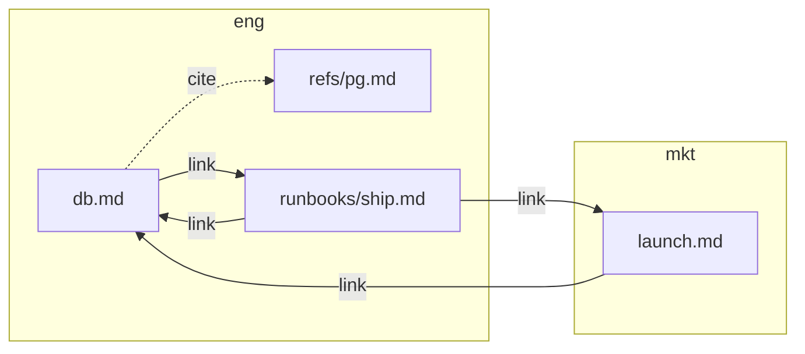

# KnowledgeBaseMCP

!!! note "AI-generated"
    These pages were written with Claude Opus 5.5 and are under human review.

An MCP server and command line for [Open Knowledge Format][okf] (OKF) v0.2
knowledgebases: directories of Markdown concepts with YAML frontmatter,
grouped into bundles. It checks, maintains and imports them. It cares how a
concept is written, never what it says.

One contract, three users:

- **An agent** over MCP: every tool, with diffs before writes and a
  confirmation prompt before anything records a human.
- **CI**: `lint` with GitHub annotations or SARIF, a baseline for old
  findings, `since=` for pull requests.
- **A person at a terminal**, no AI involved: `help`, readable text output,
  and `--attest` to sign your own reviews.

Local files only. No network. Never writes to git. One Python file, run with
[uv](https://docs.astral.sh/uv/).

## Quickstart

```sh
uv run KnowledgeBaseMCP.py init bundle=eng apply=true        # a bundle
uv run KnowledgeBaseMCP.py create eng/runbooks/deploy type=Playbook description="How we deploy."
uv run KnowledgeBaseMCP.py lint format=text                  # what's wrong, each with a fix
uv run KnowledgeBaseMCP.py fix apply=true                    # the mechanical repairs
uv run KnowledgeBaseMCP.py help move                         # any tool: what it does, its arguments
```

Register it with Claude Code:

```sh
claude mcp add knowledgebase --env KB_ROOT=/path/to/kb -- uv run /path/to/KnowledgeBaseMCP.py
```

## What a knowledgebase looks like

`web format=mermaid` draws the links between bundles or concepts:



Next: the [guide](guide.md) for layout and workflows, the [tools](tools.md)
for every command.

[okf]: https://github.com/GoogleCloudPlatform/knowledge-catalog/blob/bad9bdbafa82c672b00d437d4f2cc8f17e9e5f58/okf/SPEC.md
